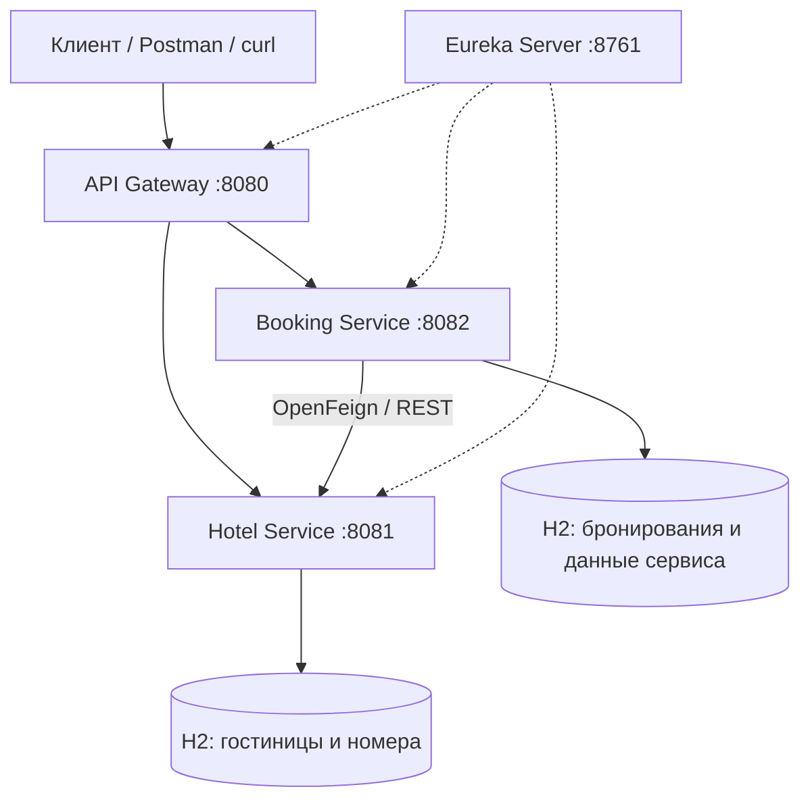

# FSRA Final Project – система бронирования отелей

Итоговый проект по модулю **«Фреймворк Spring и работа с REST API»**   
НИЯУ МИФИ ИИКС РПО, MIFIDEV-3sem 2026  
Студент: Иван В. Беликов

## 1. Назначение

Проект представляет собой REST API для управления гостиницами, номерами и бронированиями на основе микросервисной архитектуры Spring Boot. Запросы клиентов поступают через API Gateway, а сервисы обнаруживают друг друга через Eureka Server.

Основные задачи системы: работа с каталогом гостиниц и номеров, оформление и просмотр бронирований, разграничение прав пользователей с помощью JWT, взаимодействие сервисов при подтверждении бронирования.

## 2. Технологический стек

- Java 17+
- Spring Boot 3.5.x
- Spring Cloud Gateway, Netflix Eureka, OpenFeign
- Spring Web / REST API
- Spring Security, JWT (HS256)
- Spring Data JPA / Hibernate, H2
- Maven, JUnit и Spring Boot Test

Проект запускается локально. Зависимости загружаются Maven автоматически.

## 3. Архитектура



| Модуль | Порт | Назначение |
| --- | ---: | --- |
| `eureka-server` | `8761` | Реестр и обнаружение микросервисов |
| `api-gateway` | `8080` | Единая точка входа, маршрутизация и проверка JWT |
| `hotel-service` | `8081` | Управление гостиницами и номерами |
| `booking-service` | `8082` | Создание и управление бронированиями, интеграция с Hotel Service |

Взаимодействие `booking-service` с `hotel-service` реализовано через HTTP-клиент OpenFeign. Каждый сервис отвечает за собственную бизнес-логику и данные; общая распределенная транзакция БД не используется.

## 4. Требования для запуска

1. JDK 17 или новее.
2. Использовать IntelliJ IDEA с поддержкой Maven **или** установленный Maven.
3. Открыть корневой `pom.xml` как Maven-проект и дождаться загрузки зависимостей.
4. Убедиться, что порты `8761`, `8080`, `8081`, `8082` свободны.


## 5. Запуск приложения

В IntelliJ IDEA последовательно запустить главные классы приложений:

1. `EurekaServerApplication` (`eureka-server`).
2. Главный класс приложения `hotel-service`.
3. `BookingServiceApplication` (`booking-service`).
4. Главный класс приложения `api-gateway`.

После запуска откройте панель Eureka: **http://localhost:8761**. В списке зарегистрированных приложений должны появиться сервисы проекта.

Основная точка входа для REST-запросов: **http://localhost:8080**. Прямые порты `8081` и `8082` предназначены преимущественно для локальной диагностики.

Для сборки всего проекта из корня:

```bash
mvn clean verify
```

Команда компилирует модули и выполняет автоматические тесты. Последняя проверка: `mvn clean verify` завершилась BUILD SUCCESS, 49 тестов без ошибок. Сквозные проверки регистрации, бронирования, CRUD и статистики также прошли.


## 6. Администратор и демонстрационные данные

Администратор создается автоматически при запуске Booking Service:

- Логин: `admin`
- Пароль: `StudyAdmin123!`
- Роль: `ADMIN`

Настройки находятся в `booking-service/src/main/resources/application.yaml`. При необходимости их можно переопределить переменными `FSRA_ADMIN_USERNAME` и `FSRA_ADMIN_PASSWORD`.

Одинаковый `FSRA_JWT_SECRET` используется во всех сервисах; для локальной демонстрации уже предусмотрено значение по умолчанию. После запуска четырех приложений выполните в PowerShell:

```powershell
./Init-TestData.ps1
```

Скрипт получает JWT администратора, создает трех пользователей, три отеля и девять номеров. Базы Booking и Hotel находятся в памяти: данные исчезают при остановке соответствующего приложения. После перезапуска повторите заполнение. Пароли демонстрационных пользователей: `TestUser1123!`, `TestUser2123!`, `TestUser3123!` (без символов форматирования: шаблон `TestUser${i}123!`).

## 7. Авторизация и API

Регистрация: `POST /api/users/register`, JSON `{"username":"student","password":"Student123!"}`. В ответе данные пользователя и JWT: accessToken, tokenType=Bearer, expiresIn=3600. Вход: `POST /api/users/auth` с теми же полями; доступен напрямую в Booking и через Gateway. Существующий `POST /api/auth/login` также сохранен. Ответ содержит `accessToken`; срок JWT – 3600 секунд. Для дальнейших запросов передавайте `Authorization: Bearer <accessToken>`.

Hotel самостоятельно проверяет JWT. Чтение доступно USER/ADMIN, запись – ADMIN. Внутренние `/api/room-locks/**` доступны только служебному токену Booking и не маршрутизируются Gateway.

| Метод | Путь | Доступ |
| --- | --- | --- |
| PUT, DELETE | `/api/hotels/{id}` | ADMIN |
| POST | `/api/rooms/hotel/{hotelId}` | ADMIN |
| PUT, DELETE | `/api/rooms/{id}` | ADMIN |
| GET | `/api/rooms/recommend?checkIn=2027-01-10&checkOut=2027-01-15` | USER/ADMIN |
| GET | `/api/rooms/stats?from=2027-01-01&to=2027-02-01` | ADMIN |
| GET, POST | `/api/users` | ADMIN |
| PATCH, DELETE | `/api/users/{id}` | ADMIN |
| GET | `/api/bookings/{id}` | Владелец/ADMIN |
| GET | `/api/bookings/user/{userId}` | Владелец/ADMIN |
| PATCH | `/api/bookings/{id}/cancel` | Владелец/ADMIN |

Создание брони: `POST /api/bookings`, обязательный заголовок `Idempotency-Key: unique-request-1` и JSON:

```json
{"roomId":1,"autoSelect":false,"checkIn":"2027-01-10","checkOut":"2027-01-15"}
```

При `autoSelect:true` roomId игнорируется; выбирается первый свободный номер по timesBooked, затем ID. userId берется из JWT. Одинаковый ключ с теми же данными возвращает имеющуюся бронь, с другими – 409. `/api/rooms/available` отражает операционную доступность; занятость по датам учитывается в `/recommend`.

Основные операции каталога: `GET/POST /api/hotels`, `GET /api/hotels/{id}`, `GET /api/rooms`, `GET /api/rooms/{id}`. `POST /api/rooms` принимает hotelId, number, available; маршрут `/api/rooms/hotel/{hotelId}` также сохранен. `GET /api/rooms` возвращает операционно доступные номера, а при параметрах checkIn/checkOut учитывает занятость по датам. Общий список `GET /api/bookings` доступен ADMIN; история пользователя – `GET /api/bookings/user/{userId}`.

## 8. Согласованность и ограничения

PENDING сохраняется перед запросом в Hotel. Тайм-аут соединения – 2 секунды, ответа – 3 секунды; не более трех попыток подтверждения с увеличением задержки. Ошибка приводит к CANCELLED и освобождению номера. Если освобождение не удалось, `compensationPending` сохраняется и обрабатывается каждые 30 секунд. Данные очереди, как и остальные данные H2, существуют до остановки приложения.

Hotel сохраняет отметки отмены, чтобы позднее подтверждение не восстановило блокировку. Запросы блокировки и освобождения сериализуются общей строкой БД: это простой компромисс с ограничением пропускной способности. Подтверждение Booking атомарно меняет только PENDING; CANCELLED не заменяется поздним CONFIRMED.

ADR-006: используется общая блокировка БД для согласования lock/release и записи отмененных запросов. Преимущество – воспроизводимое поведение при конкуренции; компромисс – последовательная обработка блокировок. Пагинация включается параметрами page и size. Полное соответствие всем критериям максимального балла не заявляется.

Тесты `RoomPlanningTest`, `BookingTransitionsTest`, `CompensationRecoveryServiceTest` проверяют пересечения дат, конкурентные запросы, повторную доставку, позднее подтверждение и завершение компенсации. GatewaySecurityTest проверяет реальные JWT и HTTP 401/403/200 внутри приложения без открытия сетевого порта; он не заменяет сквозной запуск четырех сервисов.


## 9. Статистика и ошибки API

`GET /api/rooms/stats?from=2027-01-01&to=2027-02-01` (ADMIN) возвращает по каждому номеру roomId, hotelId, number, available, timesBooked, bookingsInPeriod, occupiedNights, periodNights, occupancyPercent. Период полуоткрытый: from включается, to не включается. Занятые ночи обрезаются по границам периода. Операционная недоступность показывается отдельно; процент рассчитывается от всех календарных ночей периода. Отмененные брони после успешного освобождения слота не учитываются. Пока компенсация ожидает выполнения, слот остается занятым и учитывается в статистике. timesBooked – накопительное число успешных установок блокировки, включая впоследствии отмененные брони.

Hotel и Booking возвращают для обрабатываемых ошибок запросов и конфликтов единый JSON: timestamp, status, message, path. Ошибки аутентификации/авторизации обрабатываются Spring Security отдельно.

Удаление номера с текущими или будущими блокировками запрещено (409). Отель с номерами также нельзя удалить (409). После освобождения всех актуальных слотов номер можно удалить.

Зависшие PENDING старше двух минут переводятся в CANCELLED атомарно, с compensationPending=true; фоновая компенсация освобождает слот. Проверка выполняется каждые 30 секунд. Это заменяет старое повторное подтверждение PENDING.


## 10. Архитектурные решения (ADR)

### ADR-001. Использование микросервисов

**Решение:** разделить Service Discovery, маршрутизацию, управление гостиницами и бронирование на четыре Spring Boot модуля.

**Причина:** разделение ответственности, самостоятельное развитие сервисов и демонстрация межсервисного взаимодействия. **Компромисс:** дополнительная сложность запуска и распределенного взаимодействия по сравнению с монолитом.

### ADR-002. Eureka и API Gateway

**Решение:** использовать Eureka для обнаружения экземпляров сервисов и Gateway в качестве единой точки входа.

**Причина:** клиенты не должны знать внутренние адреса всех микросервисов. **Компромисс:** Gateway и реестр становятся дополнительными инфраструктурными компонентами.

### ADR-003. H2 для учебной среды

**Решение:** использовать H2 и JPA для хранения данных в локальном окружении.

**Причина:** минимальные требования к установке и воспроизводимый запуск без отдельного сервера СУБД. **Компромисс:** конфигурация in-memory не обеспечивает постоянное хранение между перезапусками.

### ADR-004. JWT для разграничения доступа

**Решение:** передавать JWT в заголовке `Authorization` и проверять права на защищенных маршрутах.

**Причина:** отсутствие необходимости хранить состояние пользовательской сессии на Gateway. **Компромисс:** сервисам, проверяющим HS256-подпись, требуется согласованное значение ключа; необходимо защищать секрет при промышленном развертывании.

### ADR-005. Взаимодействие Booking и Hotel по REST

**Решение:** выполнять межсервисные запросы через OpenFeign вместо прямого обращения к чужой базе данных.

**Причина:** сохранение границ ответственности сервисов. **Компромисс:** сетевые ошибки и частичные сбои необходимо обрабатывать отдельно; глобальная транзакция между базами не используется.

## 11. Структура репозитория

```text
FSRA-final-project/
├── pom.xml                 # Родительский Maven-проект
├── eureka-server/          # Service Discovery
├── api-gateway/            # Маршрутизация и безопасность
├── hotel-service/          # Гостиницы и номера
├── booking-service/        # Бронирования
└── README.md               # Документация
```

Проект подготовлен в рамках учебной программы НИЯУ МИФИ. Конфигурация предназначена для локальной демонстрации и тестирования.


## Проверка проекта

Из корня: `mvn clean verify`. В тестах используются JUnit, Mockito, MockMvc и WebTestClient. Проверяются регистрация/JWT, личные операции, идемпотентность, тайм-ауты, компенсация, пересечения дат, конкурентное бронирование, удаление занятого номера и статистика. GatewaySecurityTest выполняется без сетевого порта; полный запуск четырех приложений проверяется отдельно. Для запуска JAR используйте `mvn package spring-boot:repackage`.


Внутренние методы Hotel (только INTERNAL, через Gateway запрещены):

- `POST /api/rooms/{roomId}/confirm-availability`: JSON bookingId, checkIn, checkOut; успешный ответ 201. Booking использует этот маршрут подтверждения.
- `POST /api/rooms/{roomId}/release`: JSON bookingId; успешный ответ 204. Повторное освобождение допустимо; если активная блокировка относится к другому номеру – 409.

Прежние `/api/room-locks` сохранены для совместимости. Обычная отмена и фоновая компенсация Booking используют `POST /api/rooms/{roomId}/release` с bookingId в JSON. Даже если блокировка еще не найдена, Hotel записывает отмену, чтобы поздний запрос подтверждения не занял номер.


### CircuitBreaker

Вызовы Feign к Hotel проходят через Resilience4j CircuitBreaker. При минимум 6 вызовах и доле сетевых ошибок/HTTP 5xx не менее 50% цепь открывается на 10 секунд, затем допускает 2 пробных вызова. HTTP 4xx (в частности, конфликт 409) не считаются отказом сервиса. Для освобождения номера используется отдельная цепь: недоступность подтверждения не блокирует попытку компенсации. Открытая цепь возвращает 503, который обрабатывается существующей логикой отмены и очереди компенсаций.


### Пагинация и методные роли

`GET /api/bookings` (ADMIN) и `GET /api/bookings/user/{userId}` (владелец/ADMIN) без параметров возвращают прежний JSON-массив. Параметры `?page=0&size=20` включают объект content, page, size, totalElements, totalPages. page начинается с 0, size допустим от 1 до 100. Порядок – checkIn по убыванию, затем id по убыванию. Недопустимые значения возвращают 400; проверка владельца выполняется и для страниц.

Административные операции дополнительно защищены `@PreAuthorize` и `@EnableMethodSecurity` в Booking и Hotel; проверки URL сохраняются.


### Сквозная корреляция

Заголовок `X-Trace-Id` принимается Gateway или создается автоматически. Тот же идентификатор передается в Booking и Hotel, возвращается в HTTP-ответе и присутствует в логах. Разрешены буквы, цифры, `_` и `-`, длина до 64 символов; некорректное значение заменяется новым UUID. Booking сохраняет traceId в брони, фоновая компенсация использует исходное значение. События бронирования дополнительно содержат bookingId. MDC очищается после завершения HTTP-запроса, в том числе при исключении.

### Схема данных

Каждый бизнес-сервис использует собственную in-memory H2. Между базами нет физических внешних ключей: userId/roomId/bookingId передаются через API.

| База | Таблица | Поля и ограничения |
| --- | --- | --- |
| Booking | users | id (PK), username (UNIQUE, NOT NULL), password (BCrypt, NOT NULL), role (USER/ADMIN) |
| Booking | bookings | id (PK), user_id, room_id, check_in, check_out, status, created_at, auto_select, idempotency_key (UNIQUE), compensation_pending, trace_id |
| Hotel | hotels | id (PK), name, address |
| Hotel | rooms | id (PK), hotel_id (FK => hotels.id, NOT NULL), number, available, times_booked; UNIQUE(hotel_id, number) |
| Hotel | room_locks | id (PK), room_id, booking_id (UNIQUE), check_in, check_out |
| Hotel | cancelled_reservation | id (PK) – идентификатор отмененной брони, запрещает позднее подтверждение |
| Hotel | reservation_guard | id (PK), единственная строка 1 для сериализации lock/release/delete |

Индексы первичных ключей и уникальных ограничений создает H2. Связь Hotel => Room – один ко многим через FK; room_locks.room_id хранится как идентификатор без FK, поэтому согласованность удаления обеспечивает RoomService. Периоды занятости полуоткрытые [check_in, check_out). check_in/check_out соответствуют start_date/end_date; created_at устанавливается при создании брони. Статусы: PENDING, CONFIRMED, CANCELLED. Поле available обозначает операционную доступность, а не занятость по датам. Расширения схемы используются для идемпотентности, компенсации, трассировки и защиты от поздних запросов.


### Демонстрационные бронирования и форматирование

`Init-TestData.ps1` дополнительно создает четыре сценария на 1–12 июня 2027 года: две подтвержденные брони первого номера, одну подтвержденную второго и одну отмененную третьего. Используются user1/user2/user3 и постоянные ключи идемпотентности. Повторное заполнение не создает новые брони и не увеличивает счетчики повторно. Изменение/удаление этих демонстрационных данных вручную может потребовать перезапуска обоих бизнес-сервисов для чистой демонстрации. Историю, загрузку и освобождение третьего номера можно проверить через API.

Код Java форматируется Spotless и Google Java Format. Применить стиль: `mvn spotless:apply`; проверить: `mvn spotless:check`. Проверка также выполняется в `mvn verify`. Maven загружает форматтер автоматически; отдельная установка не требуется.
